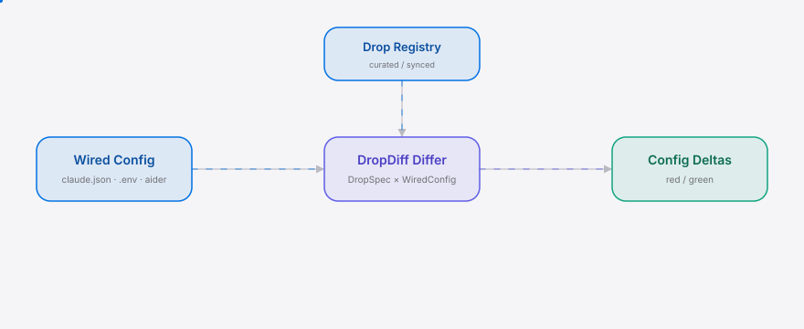
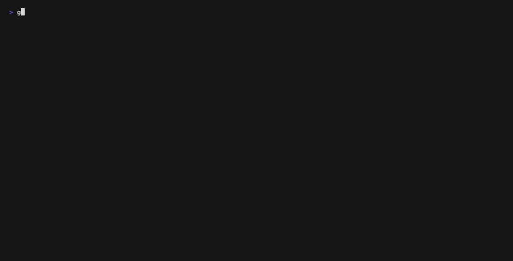

<div align="right"><sub><b>English</b> &nbsp;⇄&nbsp; [简体中文](./README.md)</sub></div>

<picture>
  <source media="(prefers-color-scheme: dark)" srcset="./assets/hero-dark.svg">
  <source media="(prefers-color-scheme: light)" srcset="./assets/hero-light.svg">
  
</picture>

<p align="center"><sub>The Renovate/Dependabot for the Chinese model carousel — one command, only the deltas that touch your wired Agent config</sub></p>

<p align="center"><strong>You no longer need to wade through five tabs every time DeepSeek / Qwen / Kimi / GLM drops — DropDiff flags only the one line that affects your already-wired config.</strong></p>

<p align="center">
  <a href="./LICENSE"></a>
  <a href="https://github.com/SuperMarioYL/dropdiff/releases"></a>
  
  
  
  
</p>

<details>
<summary>Table of contents</summary>

- [Architecture](#architecture)
- [Why this exists](#why-this-exists)
- [Install](#install)
- [Quickstart](#quickstart)
- [Usage](#usage)
- [Demo](#demo)
- [Compared to](#compared-to)
- [Configuration](#configuration)
- [Roadmap](#roadmap)
- [License](#license)
</details>

<h2> Architecture</h2>

<picture>
  <source media="(prefers-color-scheme: dark)" srcset="./assets/atlas-dark.svg">
  <source media="(prefers-color-scheme: light)" srcset="./assets/atlas-light.svg">
  
</picture>

One process, one binary, three commands. `init` snapshots your wired config as the baseline; `sync` pulls the curated drop-spec registry; `check` runs the `DropSpec × WiredConfig → ConfigDelta` triple and prints only red/green deltas. The only network call is `sync` — `check` defaults to the registry embedded in the binary, so it works with zero network.

<h2> Why this exists</h2>

Chinese-model drops don't arrive as versioned npm packages — they're scattered across ModelScope cards, 国产 SDK commit logs, and Reddit benchmark-drama threads. Reconciling a new drop (pricing / context / cache price / quants / tool-call quirks) against your **currently-wired config** is a five-tab scavenger hunt, ~2 hours a week.

DropDiff collapses it to one command. The moat is the `Affects` boolean: **"does this delta touch a field you actually wired?"** A ModelScope card is written by the model's author, who by construction doesn't know whether you wired `glm-4.6` or `deepseek-v4` — a card can tell you "Qwen3.8-Max input 14.0 ¥/M" but not "that's 28× what you wired on Qwen3-VL."

This is the weekly chore for anyone running an Agent on a Chinese endpoint — exactly the Kimi K3 cache-price delta that [@ciprianveg](https://github.com/ciprianveg) tracks, and the Deepseek V4 context-limit / quant changes that overlap [@iSyN707](https://github.com/iSyN707)'s drop coverage. For the broader Agent crowd (the [NousResearch](https://github.com/NousResearch) side of the wire), DropDiff is the "did this drop break my config" check that no generic Renovate can do — because it knows your `base_url`. `Agent` is the consuming-workflow anchor that ties the diff output back to your coding loop.

<h2> Install</h2>

**Go (recommended):**

```bash
go install github.com/SuperMarioYL/dropdiff@latest
```

**From source:**

```bash
git clone https://github.com/SuperMarioYL/dropdiff
cd dropdiff && go build -o dropdiff . && sudo mv dropdiff /usr/local/bin/
```

**Pre-built binaries:** see [Releases](https://github.com/SuperMarioYL/dropdiff/releases) — once the first tag is pushed, GoReleaser ships linux/darwin/windows × amd64/arm64 + sha256.

<h2> Quickstart</h2>

From cold clone to first visible result, two commands:

```bash
dropdiff init     # detect ~/.claude.json / ~/.aider/conf.yml / .env → snapshot to ~/.dropdiff/wired.yaml
dropdiff check    # diff this week's drops, print only red/green config-affecting deltas
```

<details>
<summary>Sample output (the GLM 5.3 cache-price catch)</summary>

```
wired: ~/.dropdiff/wired.yaml  (model=glm-4.6, base_url=https://open.bigmodel.cn)
registry: bundled  (10 drops, updated 2026-08-09)

glm-5.3  2026-07-29  [GLM]
  ✓ pricing.cache: 0.28 CNY/M -> 0.14 CNY/M
      affects your wired config — implicit cache price
  ✓ quants: fp16,int8 -> fp16,int8,fp8
      informational — quants removed=[] added=[fp8]
2 delta(s): 0 red, 2 green, 0 amber
```

</details>

<h2> Usage</h2>

```bash
# wire a Chinese-model endpoint from .env (with cache + context so deltas flag Affects)
printf 'MODEL=glm-4.6\nOPENAI_API_BASE=https://open.bigmodel.cn\nCACHE_MODE=implicit\nMAX_CONTEXT=128000\n' > .env
dropdiff init --cwd .

# pull the latest drop-spec registry (default: hosted raw GitHub; override with $DROPDIFF_REGISTRY_URL)
dropdiff sync

# list every drop in the registry (with ModelScope card + SDK commit sources)
dropdiff list

# check against a manually-specified wired config
dropdiff --config /path/to/wired.yaml check

# version
dropdiff --version
```

`init` probes `~/.claude.json → ~/.aider/conf.yml → .env` in order; the first source found for each field wins, later sources only fill gaps — so `BASE_URL` in `.env` and `model` in `claude.json` merge into one complete snapshot.

<h2> Demo</h2>



Asciinema recording (the GLM 5.3 cache-price change caught before the ModelScope card updated): [assets/demo.cast](./assets/demo.cast). The GIF is rendered from [`docs/demo.tape`](./docs/demo.tape) via vhs in CI.

<h2> Compared to</h2>

DropDiff is a diff tool — not a routing layer, not an awesome-list. The honest comparison:

| Axis | DropDiff | [berriai/litellm](https://github.com/berriai/litellm) | ModelScope card |
|---|:---:|:---:|:---:|
| Knows your wired config | ✓ | ✓ (only what you route *through* it) | ✗ |
| Per-drop red/green delta | ✓ | ✗ | ✗ |
| 国产 SDK-commit-first | ✓ | ✗ | ✗ |
| Routes/normalizes API calls | ✗ | ✓ | ✗ |
| Sees self-hosted (e.g. local Qwen) | ✓ | partial | ✗ |

DropDiff won't route your traffic — that's LiteLLM's job and it does it far better. The structural gap DropDiff closes: LiteLLM only sees what you route *through* it, so a self-hosted Qwen endpoint or a `base_url` wired straight into Claude Code is invisible to it. DropDiff reads that wired artifact directly. (The forecast's killer falsifier: if LiteLLM/OpenRouter ships a "config-affecting change detected" banner, the moat narrows to self-hosted-config users only.)

<h2> Configuration</h2>

`~/.dropdiff/wired.yaml` — snapshotted by `dropdiff init` from your claude.json / aider / .env:

| key | type | default | meaning |
|---|---|---|---|
| `model` | string | — | the model id you wired, e.g. `glm-4.6`, `deepseek-v4` |
| `base_url` | string | — | the endpoint URL you wired |
| `context` | string | — | wired max context (tokens) |
| `cache_mode` | string | — | `implicit` / `off` etc; decides whether the cache-price delta `Affects` |
| `source` | string | — | files the snapshot was parsed from (comma-separated) |

`check` prefers `~/.dropdiff/registry.yaml` (written by `sync`), falling back to the binary's bundled registry. `$DROPDIFF_REGISTRY_URL` overrides the sync source.

<h2> Roadmap</h2>

- [x] **m1 wired config** — `dropdiff init` parses claude/aider/.env → `wired.yaml`
- [x] **m2 spec registry** — curated `registry.yaml` (8 weeks of 国产 drops) + `dropdiff sync` pulls hosted JSON
- [x] **m3 diff check** — `dropdiff check` red/green config-affecting deltas + `assets/demo.cast`
- [ ] v0.2 — live 国产 SDK-commit scraping (replaces manual curation; z-ai-sdk-java et al.)
- [ ] v0.3 — multi-provider routing baseline (self-hosted Qwen etc. that OpenRouter can't see)
- [ ] v0.4 — weekly diff email / webhook (OSS-first, free for one config)

<h2> License</h2>

MIT — see [LICENSE](./LICENSE). Issues and PRs welcome at [Issues](https://github.com/SuperMarioYL/dropdiff/issues).

## Share this

```
DropDiff — the Renovate for the Chinese model carousel. One command diffs each week's DeepSeek/Qwen/Kimi/GLM drop into the red/green deltas that touch your Agent's wired config. https://github.com/SuperMarioYL/dropdiff
```

<p align="center"><sub><a href="./LICENSE">MIT</a> © 2026 SuperMarioYL</sub></p>
