**English** | [简体中文](README.md)

<picture>
  <source media="(max-width: 640px) and (prefers-color-scheme: dark)" srcset="assets/presentation/hero-mobile-dark.svg">
  <source media="(max-width: 640px)" srcset="assets/presentation/hero-mobile-light.svg">
  <source media="(prefers-color-scheme: dark)" srcset="assets/presentation/hero-dark.svg">
  
</picture>

**Compare model-spec snapshots with wired fields and distinguish relevant changes from informational deltas.**

`v0.2.0` · `Go 1.24+` · [MIT](LICENSE)

[Website](https://dropdiff.lei6393.com) · [Demo record](docs/demo-results.json)

## Why use it

Whether a context, cache or tool-call change matters depends on the configuration already in use. DropDiff compares a WiredConfig with a curated registry and retains Before, After, Affects and severity fields to identify items for further review.

## Architecture

<picture>
  <source media="(max-width: 640px) and (prefers-color-scheme: dark)" srcset="assets/presentation/architecture-mobile-dark.svg">
  <source media="(max-width: 640px)" srcset="assets/presentation/architecture-mobile-light.svg">
  <source media="(prefers-color-scheme: dark)" srcset="assets/presentation/architecture-dark.svg">
  
</picture>

config parses or reads model settings; spec loads YAML DropSpecs. The differ prefers explicit successors and can fall back to newer records from the same vendor. render labels relevant and informational changes. check/list can run offline; sync fetches a registry.

The local demo explicitly loads [data/registry.yaml](data/registry.yaml), without reading ~/.dropdiff. Its prices and source references are repository snapshot data, not current vendor facts verified by this run.

## Install

Requires Go 1.24+. The demo uses a complete explicit configuration and local registry, without a model service or user settings.

```bash
git clone https://github.com/SuperMarioYL/dropdiff.git
cd dropdiff
go build -o dropdiff .
```

## Quickstart

The real differ compares the same snapshot with implicit and off cache modes. The output exercises field-relevance rules; it does not query current pricing, SDK commits or platform settings.

```bash
go run ./examples/presentation implicit
go run ./examples/presentation off
```

The complete fixture is [examples/presentation/main.go](examples/presentation/main.go), using the shipped registry YAML.

## Usage

init can discover local configuration and write ~/.dropdiff/wired.yaml; --config selects a manual snapshot. check compares, list enumerates and sync updates the local registry. Discovery fills fields by source precedence and does not change the agent’s actual settings.

## Recorded demo

<picture>
  <source media="(max-width: 640px) and (prefers-color-scheme: dark)" srcset="assets/presentation/process-mobile-dark.svg">
  <source media="(max-width: 640px)" srcset="assets/presentation/process-mobile-light.svg">
  <source media="(prefers-color-scheme: dark)" srcset="assets/presentation/process-dark.svg">
  
</picture>

### Cache enabled

Implicit cache mode marks the cache-price field as relevant.

```text
$ go run ./examples/presentation implicit
Local registry snapshot: 2026-08-09; fixture cache_mode=implicit

glm-5.3  2026-07-29  [GLM]
  ✓ pricing.cache: 0.28 CNY/M -> 0.14 CNY/M
      affects your wired config — implicit cache price
  ✓ quants: fp16,int8 -> fp16,int8,fp8
      informational — quants removed=[] added=[fp8]
2 delta(s): 0 red, 2 green, 0 amber
```

### Cache disabled

With cache off, the same field is informational.

```text
$ go run ./examples/presentation off
Local registry snapshot: 2026-08-09; fixture cache_mode=off

glm-5.3  2026-07-29  [GLM]
  ✓ pricing.cache: 0.28 CNY/M -> 0.14 CNY/M
      informational — implicit cache price
  ✓ quants: fp16,int8 -> fp16,int8,fp8
      informational — quants removed=[] added=[fp8]
2 delta(s): 0 red, 2 green, 0 amber
```

## Capabilities and integration

<picture>
  <source media="(max-width: 640px) and (prefers-color-scheme: dark)" srcset="assets/presentation/integrations-mobile-dark.svg">
  <source media="(max-width: 640px)" srcset="assets/presentation/integrations-mobile-light.svg">
  <source media="(prefers-color-scheme: dark)" srcset="assets/presentation/integrations-dark.svg">
  
</picture>

Comparison depends on registry quality. Explicit successors are preferred over same-vendor date fallback, and prices compare only when units match. Reports help select changes to verify rather than replacing source verification.


## Configuration

WiredConfig includes model, base_url, context, cache_mode and source. check prefers ~/.dropdiff/registry.yaml and otherwise uses the bundle. DROPDIFF_REGISTRY_URL controls sync. Empty/off/none/false cache modes make cache-price deltas non-affecting; quant changes remain informational.

## Roadmap and scope

Configuration parsing, snapshot diffs and registry synchronization are implemented. Automatic SDK monitoring, multiple-provider baselines and scheduled notifications remain future work; configuration upgrades are not applied automatically.

- Bundled prices and source references were not verified as live vendor information.
- Same-vendor fallback can include models that are not direct upgrades.
- The tool reports differences without changing agent configuration or performing upgrades.

[Terminal recording](assets/demo.gif) · [Recording script](docs/demo.tape)

## License

[MIT](LICENSE)
